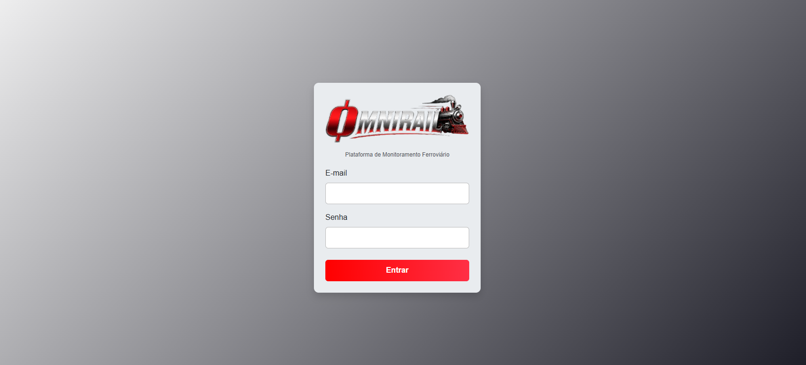
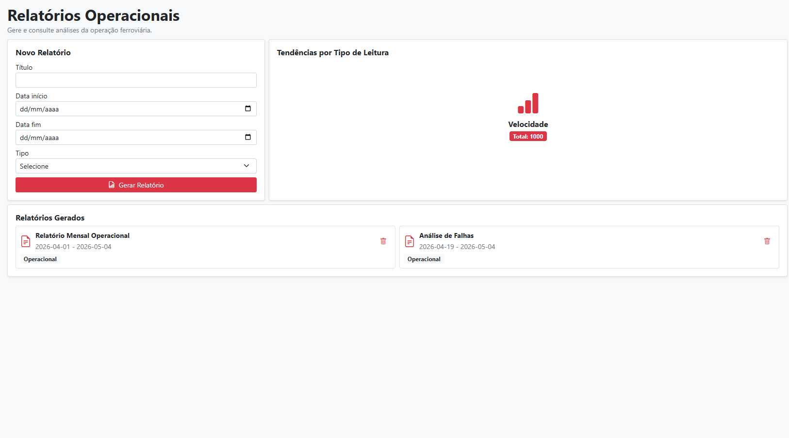
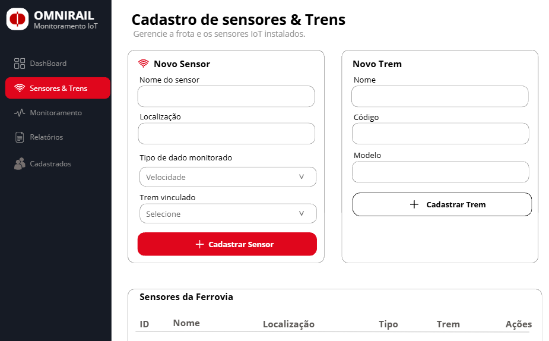
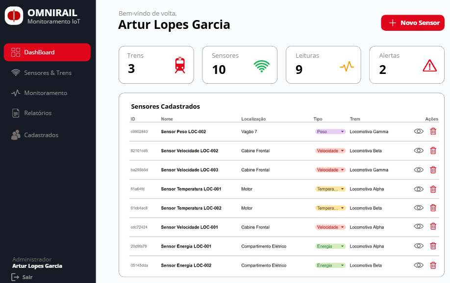

<div align="center">

<!-- Se quiser exibir a logo, salve-a em docs/logo.png e descomente a linha abaixo -->
<!--  -->

# OMNIRAIL

**Sistema Inteligente de Gerenciamento Ferroviário**
Monitoramento de ferrorama em tempo real com sensores IoT


</div>

---

## Sumário

- [Sobre o projeto](#sobre-o-projeto)
- [Problema que resolve](#problema-que-resolve)
- [Objetivos e funcionalidades](#objetivos-e-funcionalidades)
- [Tecnologias](#tecnologias)
- [Requisitos](#requisitos)
- [Instalação e configuração](#instalação-e-configuração)
- [Banco de dados](#banco-de-dados)
- [Executando a aplicação](#executando-a-aplicação)
- [Perfis de acesso](#perfis-de-acesso)
- [Estrutura do projeto](#estrutura-do-projeto)
- [Capturas de tela](#capturas-de-tela)
- [Limitações conhecidas](#limitações-conhecidas)
- [Metodologia e identidade visual](#metodologia-e-identidade-visual)
- [Equipe](#equipe)
- [Contato](#contato)

---

## Sobre o projeto

O **OMNIRAIL** é um sistema web de gerenciamento e monitoramento de operações ferroviárias, desenvolvido para uma **ferrorama**. A plataforma centraliza trens, sensores, leituras e alertas e acompanha as etapas significativas da operação: do cadastro de funcionários, operadores e administrador até o cálculo de tempo feito simultaneamente ao trajeto do trem, a partir de sensores instalados no próprio trem.

O nome é inspirado no personagem Omni-Man, da série *Invencível*, e remete a força, controle e alta performance na gestão ferroviária.

## Problema que resolve

O projeto nasceu da **defasagem e da invisibilidade comercial dos sistemas ferroviários**. Sem uma visão unificada, é difícil acompanhar velocidade, consumo de energia, localização e falhas de cada trem, o que prejudica o controle operacional, a manutenção e a segurança.

O OMNIRAIL reúne esses dados em uma interface única, alimentada por sensores IoT, com histórico de falhas e relatórios.

## Objetivos e funcionalidades

**Objetivo:** oferecer uma solução moderna e eficiente de monitoramento ferroviário em tempo real, apoiando o controle operacional, a manutenção preditiva e a segurança da ferrovia.

| Módulo | Descrição |
|---|---|
| **Login** | Acesso por e-mail e senha, com validação no banco, criação de sessão e mensagem de erro para credenciais inválidas. |
| **Dashboard** | Área restrita com o nome do administrador, indicadores (trens, sensores, leituras e alertas), lista de sensores e acesso rápido às funções. |
| **Sensores e Trens** | Cadastro de sensores (nome, localização e tipo de dado monitorado), vinculados obrigatoriamente a um trem, e cadastro de trens. |
| **Listagem de sensores** | Detalhes de cada sensor e exclusão de sensores sem dados registrados. |
| **Monitoramento** | Velocidade, consumo de energia, temperatura, localização em mapa, status operacional, histórico de falhas e gráficos analíticos. |
| **Relatórios** | Geração de relatórios por período e por tipo de falha, com gráficos de tendência. |
| **Funcionários cadastrados** | Cadastro dos usuários do sistema (nome, CPF, e-mail, senha, perfil de acesso e endereço). |
| **Alertas** | Indicação de situações que exigem análise do operador. |
| **Logout** | Encerra a sessão e retorna ao login. |

<details>
<summary><strong>Regras de negócio</strong></summary>

1. Todo sensor cadastrado deve estar vinculado a um trem.
2. Sensores com dados registrados não podem ser excluídos.
3. O sistema simula dados em tempo real a partir de sensores IoT.
4. O status operacional do trem é definido automaticamente pelos dados recebidos.
5. Os relatórios são gerados a partir dos dados históricos do banco.
6. O dashboard é acessível apenas a usuários autenticados.
7. São armazenados velocidade, localização, consumo de energia e falhas operacionais.
8. As informações são apresentadas de forma organizada, intuitiva e responsiva.

</details>

<details>
<summary><strong>CRUD</strong></summary>

Implementado em PHP integrado ao MySQL:

- **Create:** cadastro de usuários, sensores, trens e relatórios.
- **Read:** sensores cadastrados, dados em tempo real, relatórios e gráficos.
- **Update:** status de sensores (ex.: "Alerta" ou "Falha"), dados operacionais e informações dos trens.
- **Delete:** sensores, registros incorretos e dados antigos, respeitando a regra 2.

</details>

## Tecnologias

| Camada | Tecnologia |
|---|---|
| Frontend | HTML, CSS, JavaScript e Bootstrap |
| Gráficos e mapa | Gráficos interativos em JavaScript e mapa Leaflet com OpenStreetMap |
| Backend | PHP |
| Banco de dados | MySQL / MariaDB |
| Ambiente local | XAMPP (Apache, PHP, MariaDB, phpMyAdmin) |
| Gestão | Scrum, com quadro Kanban no GitHub |

## Requisitos

- [XAMPP](https://www.apachefriends.org/) com Apache, PHP e MySQL/MariaDB
- Navegador moderno (Chrome, Edge ou Firefox)
- Conexão com a internet (mapa e bibliotecas externas)
- Git (opcional, para clonar o repositório)

## Instalação e configuração

**1. Clone o repositório** dentro da pasta `htdocs` do XAMPP:

```bash
cd C:/xampp/htdocs
git clone https://github.com/LPS-coder/Atividade-SA.git
```

> Também é possível baixar o `.zip` pelo GitHub e extraí-lo em `htdocs`.

**2. Inicie o Apache e o MySQL** no Painel de Controle do XAMPP.

**3. Configure a conexão com o banco** no arquivo PHP de conexão do projeto. Os valores padrão do XAMPP são:

```php
$host = "localhost";
$user = "root";
$pass = "";           // vazio por padrão no XAMPP
$db   = "omnirail";   // criado pelo script database/omnirail.sql
```

<!-- AJUSTAR: informe o caminho do arquivo de conexão (ex.: php/conexao.php). -->

## Banco de dados

O banco `omnirail` é criado pelo script [`database/omnirail.sql`](database/omnirail.sql), que também cadastra o **administrador padrão** do sistema.

### Importação

1. Com Apache e MySQL ativos, acesse o phpMyAdmin em <http://localhost/phpmyadmin>.
2. Na tela inicial (sem nenhum banco selecionado), abra a aba **Importar**, escolha o arquivo `database/omnirail.sql` e clique em **Executar**.

O script cria o banco `omnirail`, todas as tabelas e o administrador padrão. Pela linha de comando:

```bash
mysql -u root < database/omnirail.sql
```

> **Reexecução:** o script usa `IF NOT EXISTS` e pode ser rodado de novo, mas o `ALTER TABLE` final (colunas de endereço) falha se já tiver sido aplicado, e o `INSERT` do administrador restaura a senha e o perfil padrão dele.

### Tabelas

| Tabela | Finalidade | Principais campos |
|---|---|---|
| `funcionario` | Usuários do sistema | `id_funcionario`, `nome_funcionario`, `cpf_funcionario` (único), `email_funcionario` (único), `senha_funcionario`, `tipo_usuario`, endereço (`cep`, `logradouro`, `numero`, `bairro`, `cidade`, `uf`) |
| `trens` | Trens cadastrados | `id_trem`, `nome_trens`, `codigo` (único), `modelo`, `id_funcionario` |
| `sensores` | Sensores instalados nos trens | `id_sensor`, `nome_sensores`, `localizacao`, `tipo_dado`, `id_trem` |
| `rotas` | Trajetos dos trens | `id_rota`, `nome_rota` (único), `descricao_rota`, `distancia_km`, `tempo_previsto_min`, `data_criacao`, `id_trem` |
| `monitoramento` | Sessões de monitoramento de um trem | `id_monitoramento`, `id_funcionario`, `id_trem`, `id_rota`, `data_inicio`, `data_fim`, `status` (`ATIVO`, `PAUSADO`, `FINALIZADO`), `descricao` |
| `dados_monitoramento` | Leituras dos sensores em cada sessão | `id_dado`, `id_monitoramento`, `id_sensor`, `valor_registrado`, `unidade`, `data_registro`, `descricao` |
| `relatorios` | Relatórios gerados | `id_relatorio`, `id_funcionario`, `id_sensor`, `id_trem`, `data_geracao`, `descricao` |

### Integridade e segurança

- **Sensor sempre vinculado a um trem:** `sensores.id_trem` é obrigatório e é chave estrangeira.
- **Sensores com dados não podem ser excluídos:** as chaves estrangeiras de `dados_monitoramento` e `relatorios` impedem a exclusão de um sensor já referenciado.
- **Dados únicos:** CPF, e-mail, código do trem e nome da rota não podem se repetir.
- **Senhas com hash:** `senha_funcionario` guarda hash bcrypt (`$2y$`), nunca a senha em texto puro.
- **Perfil de acesso:** `tipo_usuario` aceita `ADMINISTRADOR`, `OPERARIO` e `USUARIO` (padrão).

## Executando a aplicação

1. Com Apache e MySQL ativos e o banco importado, acesse:

   ```
   http://localhost/artur_lopes_2026/Atividade-SA/public/login.html
   ```

   <!-- AJUSTAR: o caminho depende da pasta em que o projeto está dentro de htdocs. -->

2. Informe e-mail e senha e clique em **Entrar**. O script do banco cria o administrador padrão `omnirail@gmail.com`.

   <!-- AJUSTAR: documente aqui a senha inicial do administrador, se desejar. -->

3. Você será direcionado ao **Dashboard**.
4. Para encerrar, use **Sair** no menu lateral.

> Acesse sempre por `http://localhost`. Abrir os arquivos direto pelo navegador (`file:///`) impede o PHP de funcionar e o mapa é bloqueado pelo OpenStreetMap.

## Perfis de acesso

O perfil de cada usuário é definido pelo campo `tipo_usuario` da tabela `funcionario`.

| Perfil | Permissões |
|---|---|
| **ADMINISTRADOR** | Acesso completo: dashboard, sensores e trens, monitoramento, relatórios, alertas e gerenciamento de funcionários. |
| **OPERARIO** | Monitoramento em tempo real, alertas e consulta de relatórios. |
| **USUARIO** (padrão) | Perfil padrão de novos cadastros, com acesso conforme definido pela administração. |

O dashboard só pode ser acessado por usuários autenticados.

## Estrutura do projeto

```
Atividade-SA/
├── public/              # Páginas do sistema (login.html, dashboard, etc.)
├── php/                 # Scripts PHP: login, CRUD, sessão e logout
├── assets/              # CSS, JavaScript e imagens
├── database/            # Script SQL do banco
├── docs/
│   └── screenshots/     # Capturas de tela
└── README.md
```

<!-- AJUSTAR: substitua pela estrutura real do repositório (rode `tree /F` na pasta do projeto). -->

## Capturas de tela

| Login | Dashboard |
|---|---|
|  |  |

| Sensores e Trens | Monitoramento |
|---|---|
|  |  |

| Relatórios | Funcionários cadastrados |
|---|---|
|  |  |

## Limitações conhecidas

- Os dados dos sensores são **simulados**; não há sensores físicos conectados.
- O mapa depende de internet e não carrega se a página for aberta via `file:///`.
- O sistema roda apenas em ambiente local (XAMPP) e ainda não foi publicado.
- A diferenciação de permissões entre `OPERARIO` e `USUARIO` é limitada.
- O script SQL cadastra apenas o administrador padrão; trens, sensores e demais dados de teste precisam ser cadastrados pelo sistema.
- Os valores lidos dos sensores são guardados como texto (`valor_registrado`), o que limita cálculos diretos no banco.
- A exportação de relatórios depende de estar disponível na versão atual.

## Metodologia e identidade visual

O desenvolvimento segue o **Scrum** (Sprint Planning, Daily Scrum, Sprint Review e Sprint Retrospective), com tarefas acompanhadas em um quadro **Kanban no GitHub**.

A interface é moderna, tecnológica, corporativa, minimalista e funcional, com cards, gráficos, ícones simples e bordas arredondadas.

| Cor | Código | Uso |
|---|---|---|
| Vermelho | `#E30613` | Destaque, energia e alertas |
| Branco | `#FFFFFF` | Legibilidade |
| Cinza claro | — | Fundo |
| Verde, amarelo e vermelho | — | Status operacionais |

## Equipe

| Integrante | 
|---|---|---|
| Artur Lopes Garcia | 
| Otto José Sestrem da Silva | 
| Lucas Silva Amaral| 
| Fernando Luigi Gadotti | 


---

<div align="center">OMNIRAIL · 2026</div>
